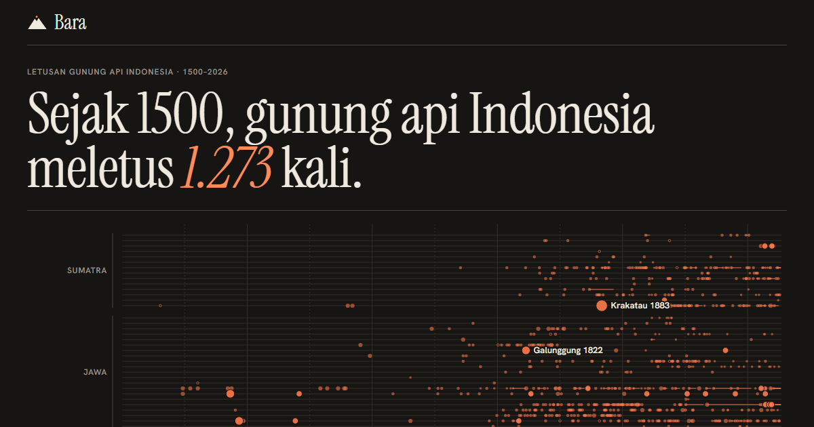

# Bara



**[Buka Bara](https://bara.raffstw.my.id)**

Semua letusan gunung api Indonesia yang tercatat pasti sejak 1500, dari Aceh sampai
Halmahera, dari basis data *Volcanoes of the World* milik Smithsonian Global Volcanism
Program.

- **Garis waktu letusan**: satu baris per gunung, berurutan menyusuri busur vulkanik;
  satu titik per letusan, besarnya sesuai VEI. Letusan yang berlangsung bertahun-tahun
  digambar sebagai garis, termasuk Dukono yang erupsi terus sejak 1933.
- **Di sekitar daerahmu**: pilih satu dari 514 kabupaten/kota dan radius 50, 100, atau
  200 km. Hasilnya gunung api terdekat dengan jarak dan arahnya, jumlah letusan, letusan
  terbesar dan terakhir, serta peta kecil.
- **Peta 101 gunung api**: diwarnai menurut kapan terakhir meletus, ukurannya menurut
  seberapa sering. Gunung yang masih erupsi diberi cincin. Setiap gunung punya kartu
  riwayat sendiri (`#gunung=263250`).
- **Skala VEI** dengan jumlah letusan dan contoh terbaru di tiap tingkat, tiga letusan
  raksasa (Samalas 1257, Tambora 1815, Krakatau 1883), dan gunung yang paling sering
  meletus.
- Mode gelap mengikuti sistem.

## Data

| Data | Sumber |
|---|---|
| Gunung api Holosen dan letusannya | [Global Volcanism Program, Smithsonian Institution](https://volcano.si.edu/), layanan WFS *Volcanoes of the World* |
| Batas dan titik tengah kabupaten/kota | geoBoundaries ADM2 (BPS, WFP, OCHA ROAP; CC BY 3.0 IGO) |

Hanya letusan berstatus *confirmed* yang dihitung. Tanggal yang dipakai adalah awal
letusan, bukan puncaknya (GVP mencatat Krakatau 1883 mulai 20 Mei, puncaknya 26–27
Agustus). Letusan yang tanggal akhirnya bertanda `>` di tahun pembaruan data dianggap
masih berlangsung.

Letak kabupaten/kota tiap gunung ditentukan dari koordinat puncaknya; gunung di
perbatasan bisa masuk kabupaten tetangga. Ini catatan sejarah, **bukan status
kegunungapian**. Untuk status dan peringatan terkini, rujukannya
[MAGMA Indonesia (PVMBG)](https://magma.esdm.go.id/).

```
npm run data                     # unduh ulang dari GVP lalu bangun src/data/bara.json
node data/skrip/bangun.mjs       # bangun ulang dari data/mentah tanpa internet
```

Peta dasar (`public/data/peta.json`) dan daftar kabupaten/kota memakai berkas yang sama
dengan [Getar](https://github.com/Reverseflash45/getar) dan
[Tebak Daerah](https://github.com/Reverseflash45/tebak-daerah).

## Warna

Kapan terakhir meletus memakai skala urut satu rona lava (sejak 2000, 1900–1999,
1500–1899), divalidasi terhadap latar terang dan gelap; yang tidak meletus sejak 1500
digambar sebagai segitiga berongga. Di mode terang yang paling baru paling gelap, di mode
gelap paling terang.

## Menjalankan

```
npm install
npm run dev
npm test        # data, jarak dan arah, letusan terbesar, teks tanggal (vitest)
npm run build
```

Vite + TypeScript, tanpa framework UI; peta dengan d3-geo dan topojson-client, semua
grafik SVG.
